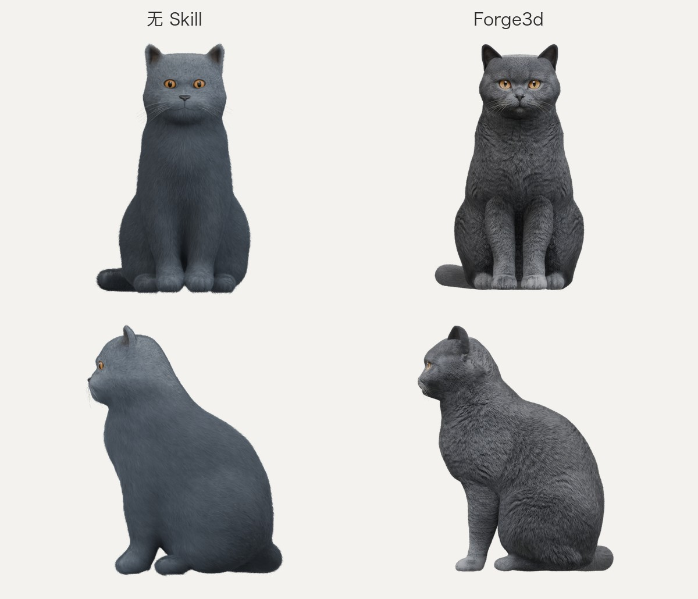

# Forge3d

**有参考图？先自己做一版可编辑的 3D 模型。**

Forge3d 是一个给 Codex 用的建模 Skill。它先量参考图的比例和轮廓，再把模型拆成可以分别制作的部件。装起来后，从不同角度对着原图检查。正常使用会交付 Blender 文件，也可以按任务生成 Blockbench 的 `.bbmodel`。

[实测对比](docs/comparisons.md) · [Skill 指令](forge3d/SKILL.md) · [Blockbench 工作流](forge3d/references/blockbench.md)



我写它是因为想试一版模型，可以先自己做。几张图、一个本地项目，就能从粗模开始改，省掉第一次找人报价或先给建模平台充值。流程、脚本和检查方式都摆在这里，欢迎拿自己的图试。

## AGI 万岁，平权万岁

我希望 Forge3d 最好的结局，是被更强的基模斩杀。哪天大家打开模型，给一张图，就能直接做出可编辑的 3D，那这个 Skill 就完成了它的任务。更强的智能，应该让所有人都能方便地用上。

在那之前，欢迎拿 Forge3d 去接单、做产品、挣钱。流程开着，代码用 MIT。我想看到这个市场变成红海，多一些能做的人，多一些能买得起、也能自己做的人。

## 开始用

本地需要 Python 3 和 [uv](https://docs.astral.sh/uv/getting-started/installation/)（或带 pip 的 Python 3.13）。启动脚本会单独安装 headless Blender 的 Python 运行环境，首次运行要下载依赖。本地建模不要求先安装 Blender 桌面软件。

```bash
git clone https://github.com/quasar2333/forge3d.git
cd forge3d
python3 forge3d/scripts/f3d.py doctor
```

把内层 `forge3d/` 文件夹（带 `SKILL.md` 的那层）复制到项目里的 `.agents/skills/forge3d/`。也可以放到 `~/.agents/skills/forge3d/`，供多个项目使用。然后在 Codex 里附上参考图，开一个建模任务。

> 用 $forge3d 照这张正侧背三视图做一个 Blender 模型。请交付可编辑的 .blend、三视图和一张斜视渲染。

> 用 $forge3d 把这张机甲图做成 Blockbench 方块模型，分件保留，输出 .bbmodel。

## 推荐配置

复杂、有明确参考图的任务，优先用 **GPT-6.2-Astra 主控 + GPT-6.2-Sol 分件**。Astra 管比例、分工、装配和验收。客户端提供子代理模型选择时，Skill 会指示主控把分件交给 Sol。只用 **GPT-6.2-Sol** 也能走完整流程，适合先试一版。复杂造型和多轮评审会消耗更多时间及模型额度。

## 输出

| 目标 | 文件 |
|---|---|
| Blender 模型 | `.blend`，可编辑几何、材质和分件 |
| 通用预览或交换 | `.glb`，按需导出 |
| Blockbench 模型 | `.bbmodel`，方块或网格视需求选择 |
| 对照 | 正面、侧面、背面、斜视及局部检查图 |

要看 Blockbench 实际导入结果，可以用自己的安装打开 `.bbmodel`，也可以运行 `python3 forge3d/scripts/f3d.py bb check 模型.bbmodel`。复杂角色的骨骼、动画和生产级拓扑需要另外约定。

## 费用

Forge3d 的代码和建模流程可以免费获取。Codex 的模型用量走你的账户，默认的本地 Blender 和 Blockbench 流程不要求向第三方建模站点付费。

## 许可证

Forge3d 的代码和文档以 [MIT 许可证](LICENSE)发布。演示中的第三方角色和素材保留各自权利。
