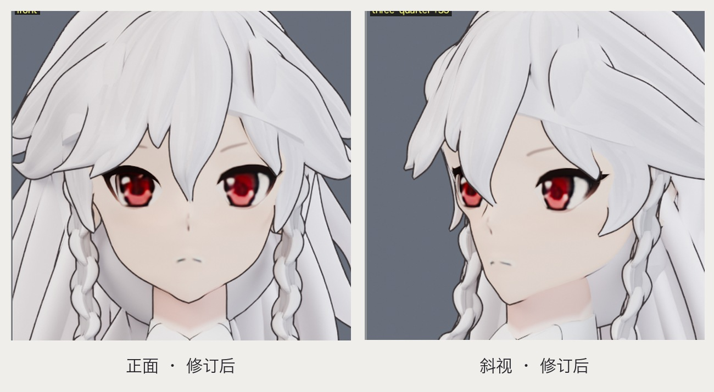
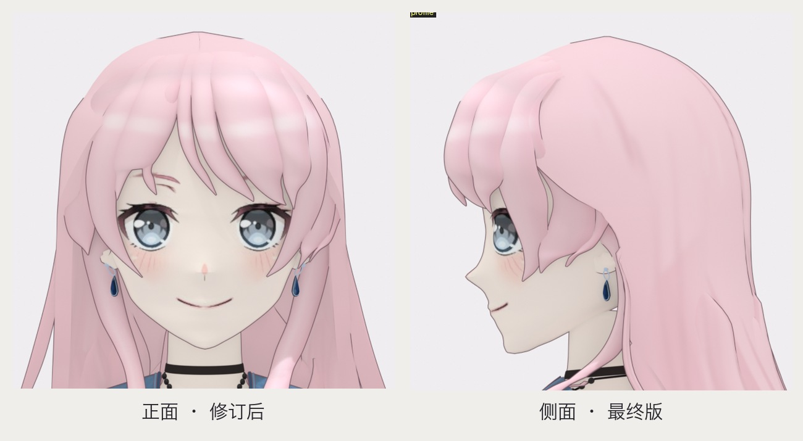
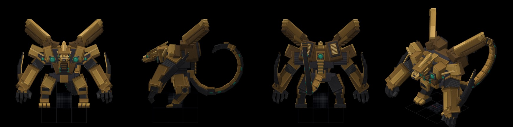

# 实测对比

以下是保存下来的实际模型渲染。每组都说明比较的是两个独立建模结果，还是同一个模型的后续改稿。单组结果会受到参考图、主控模型、时间和检查轮次影响。

## 英短蓝猫

同一套参考图，两边各自建模并修订。这里是第二轮交付的同角度渲染。可以对着看脸颊宽度、爪子是否分开、坐姿和尾巴。

## 银发角色

这组用的是完成脸部修订后的 Blender 成品。正面可以查看脸颊到下颌的收窄，斜视可以查看鼻梁、下巴和发际的衔接。两张图都从同一个最终模型渲染。

## 千早爱音

按《BanG Dream!》的三视图做的同人练习。正面和侧面均为最终模型渲染，可以看到下颌轮廓和脸颊两侧发束的位置。

## Blockbench 蝎形机甲

从参考图量出大体形状，分开做躯干、四肢和尾巴，导出可编辑的 `.bbmodel`。图里是成品的 Blockbench 实际载入结果。

## 其他测试

- 赛罗奥特曼有无 Skill 版、Forge3d 版和单列的后续精修。精修稿是同一作品的迭代。

千早爱音和赛罗是同人建模测试。角色和参考素材的权利归原权利人。原作资料见 [BanG Dream! 官网](https://bang-dream.com/artist/mygo/chihaya-anon/) 和 [圆谷官网](https://tsuburaya-prod.com/heroes/ultraman-zero)。
