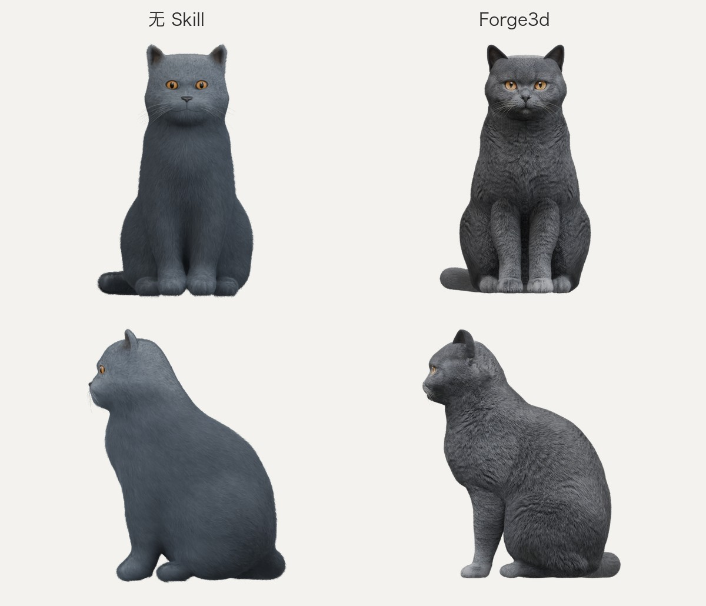
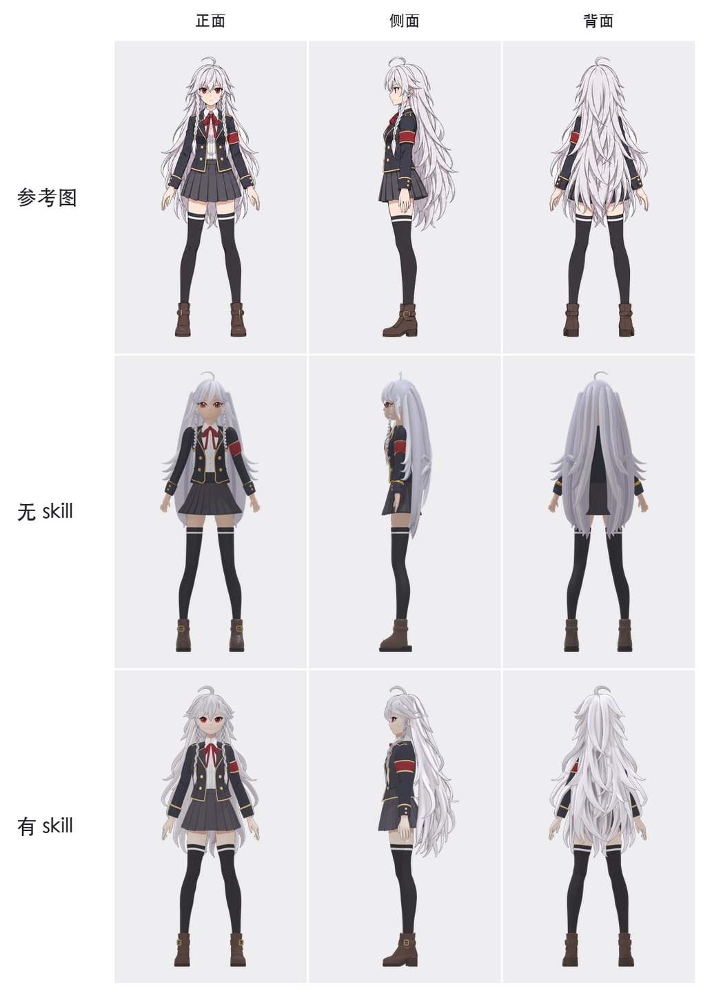

# 实测对比

以下是保存下来的实际模型渲染。每组都说明比较的是两个独立建模结果，还是同一个模型的后续改稿。单组结果会受到参考图、主控模型、时间和检查轮次影响。

## 英短蓝猫

同一套参考图，两边各自建模并修订。这里是第二轮交付的同角度渲染。可以对着看脸颊宽度、爪子是否分开、坐姿和尾巴。

## 银发角色

同一张合成三视图，两次任务分别启用和关闭 Skill。侧面发量、背部发束和髋腿连接的差异最明显。这是较早的工作流测试，启用 Skill 的一版有额外的分件检查和装配检查，花的时间更长。

## Blockbench 蝎形机甲

从参考图量出大体形状，分开做躯干、四肢和尾巴，导出可编辑的 `.bbmodel`。图里是成品的 Blockbench 实际载入结果。

## 其他测试

- 千早爱音（《BanG Dream!》）有独立的无 Skill 版和 Forge3d 版，两版以同机位对照侧脸和发束。
- 赛罗奥特曼有无 Skill 版、Forge3d 版和单列的后续精修。精修稿是同一作品的迭代。

这两组角色是建模流程的同人测试，角色、参考图和模型文件无需随 Skill 下载。原作资料见 [BanG Dream! 官网](https://bang-dream.com/artist/mygo/chihaya-anon/) 和 [圆谷官网](https://tsuburaya-prod.com/heroes/ultraman-zero)。
